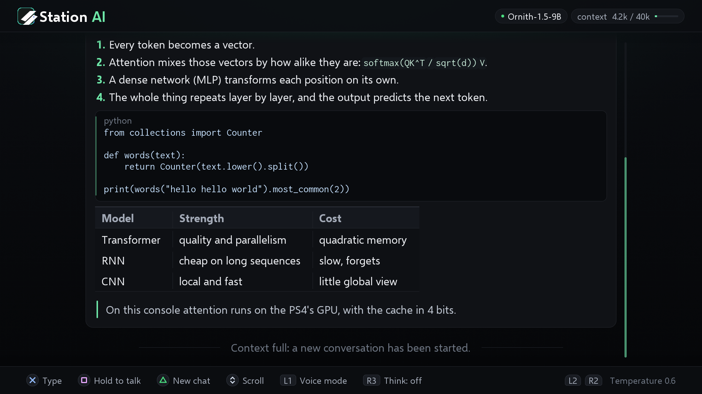
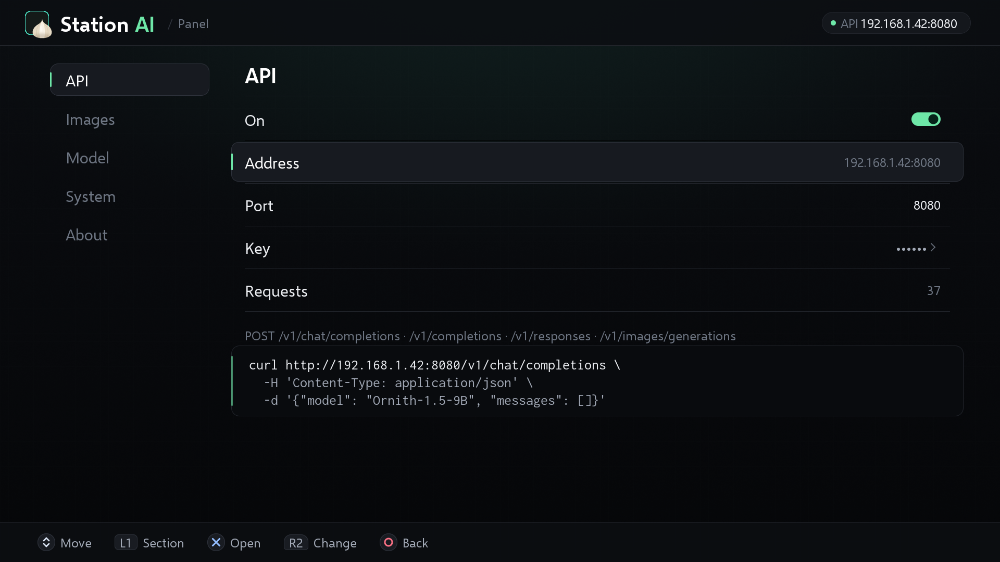

# Station AI · Ornith-1.5-9B

**Station AI** is this fork of [Garlic LLM](https://github.com/leonardo-alegria/garlic-llm): the same console app,
renamed, with a context that follows the console's memory instead of a constant, and a way to download a model on
the console itself. Garlic LLM runs a 9-billion-parameter language model on a PlayStation 4's own GPU, offline. Upstream it runs Qwen3.5-9B; **this repository runs
[Ornith-1.5-9B](https://huggingface.co/ornith-ai/Ornith-1.5-9B-GGUF) instead**, converted from the model's GGUF into
the formats the console's kernels read, and built as a PS4 package by GitHub Actions.

Ornith-1.5-9B is the same architecture as Qwen3.5-9B (llama.cpp's `qwen35`: 32 layers, 4096 hidden, 256-wide
attention heads, three Gated DeltaNet layers per full-attention one, a 1-layer MTP head), so the app's compute
kernels, its weight formats, its 4-bit attention cache and its speculative decoding all carry over unchanged. What
changes is the weights, the layout inside them, the names in the indexes and a few strings.

The model is a far stronger one: Ornith-1.5-9B scores 70.6 on SWE-bench Verified, 86.4 on GPQA Diamond and 46.2 on
Terminal-Bench 2.1, against 53.2 / 81.7 / 21.3 for Qwen3.5-9B on the same table in its model card.

## What is in here

| Path | What it is |
| --- | --- |
| `pc/ornith_convert.py` | **the port**: Ornith-1.5-9B's GGUF → the four files the app reads, in the layout of the shipped 9B |
| `pc/gguf.py` | a GGUF reader with no dependencies beyond numpy (metadata, tensor table, dequantization of F32/F16/BF16/Q8_0/Q4_0/Q4_K/Q5_K/Q6_K, by byte range) |
| `pc/ornith_check_layout.py` | compares the GGUF's tensors with Hugging Face's checkpoint: the order of the delta rule's value heads, the norms, a row of each matrix |
| `pc/vocab_order.npy`, `chat/assets/tokenizer.bin` | the app's vocabulary and the lm_head keep list: Ornith's tokens and merges are identical to Qwen3.5's, so both are used unchanged |
| `pc/ci_toolchain.py` | fetches the OpenOrbis PS4 toolchain, Zig and the OpenSSL 1.1 the package tool needs |
| `.github/workflows/build.yml` | compile, convert and package as three jobs on GitHub Actions; publishes the package as a 4.9 GB artifact |
| `.github/workflows/probe.yml` | cheap checks: what the GGUF holds, what the toolchain release holds |
| `chat/ui.c` | the whole interface: theme, header, cards, markdown tables and code panels, keyboard, voice sheet, loading and error cards, the panel |
| `chat/panel.inc` | the panel itself (OPTIONS): five sections — API, images, model, system, about — and the file each one writes |
| `pc/ui_preview.c` | the same screens rendered on a PC to a PNG (`chat/ui.c` only), so the look can be checked without the console |
| `chat/api.c`, `chat/api_proto.c`, `chat/api_run.inc` | the OpenAI-compatible server: chat, completions, responses, models, SSE, the OpenAPI document |
| `chat/imgen.c`, `chat/img.c`, `chat/png.c` | image models through the API: the backend's answer, a PNG reader (inflate) and a PNG writer, by hand |
| `tests/api_proto_test.c`, `tests/api_run_test.c`, `tests/img_test.c` | the API's protocol, its jobs (with a mock engine) and the PNG reader, on a PC |
| `chat/`, `shaders/`, `build_chat.py`, … | Garlic LLM itself, unchanged except for the model's name and the package's files |

## The conversion

`python pc/ornith_convert.py convert --gguf models/Ornith-1.5-9B-BF16.gguf` writes:

```
models/ornith-1.5-9b-q4s.bin    [GPU part: final_norm, 32 layers, trimmed lm_head][input-embedding rows][token ids]
models/ornith-1.5-9b-mtp.bin    the MTP head in q4s + the embedding rows of the 32 768 tokens it drafts
chat/assets_9b/model.idx        PMQ5: the shape, and where every tensor sits in the file
chat/assets_9b/mtp.idx          PMTP: the same for the draft head
```

The formats are the ones the shipped 9B uses, chosen for what the console has (`shaders/spec.h`, `shaders/qwen35.cl`):

| Tensors | Format | Why |
| --- | --- | --- |
| MLP gate and up (32 × 12 288 × 4096) | `q3s` | 3.5 bits a weight: the two biggest matrices, in the format that fits the console's memory |
| every other matrix | `q4s` | 4.5 bits a weight, with the SWAR dot products (`swar_mv1..4`) |
| input embedding | `q4row` | kept out of GPU memory: the CPU reads the one row of each token from the file |
| `lm_head` | 4 bits, 248 070 of 248 320 rows | the rows of `pc/vocab_order.npy`, the token ids by frequency, plus the id of each row |
| norms, `conv1d`, `A`, `dt_bias`, `gnorm` | f32 | as the kernels read them |

GPU memory: about 3.8 GiB of weights, plus the caches — the same budget the Qwen3.5 build lives in.

### Three things the GGUF does differently, and how they are undone

1. **The norms are stored as `1 + w`.** llama.cpp writes Qwen3.5's RMSNorm weights already offset. The app's kernels
   add the same 1, so they are written out as they come — *except* the delta rule's `ssm_norm`, which is a plain
   weight in both and is kept plain. (`pc/ornith_check_layout.py` shows the ±1 for every norm.)
2. **The delta rule's value heads are in llama.cpp's order.** llama.cpp reads the 32 value heads as
   (16 key heads × 2) transposed, so its head *i* is Hugging Face's `i // 2 + (i % 2) * 16`. That one permutation
   reaches `ssm_a`, `ssm_dt.bias`, `ssm_beta`, `ssm_alpha`, `ssm_out`'s columns, `attn_gate`'s rows, `attn_qkv`'s
   value rows and `ssm_conv1d`'s value channels. The converter puts them back in Hugging Face's order, which is what
   the app's kernels were written against; `pc/ornith_check_layout.py` checks it tensor by tensor.
3. **`ssm_a` is already `-exp(A_log)`.** The converter keeps it (and says so if a future GGUF ever ships the log).

The **MTP head** (speculative decoding) is in the GGUF too: llama.cpp writes it as one more block after the model's
layers, `blk.32.*`, with `nextn.enorm`, `nextn.hnorm`, `nextn.eh_proj` and `nextn.shared_head_norm` — Hugging Face's
`mtp.pre_fc_norm_embedding`, `pre_fc_norm_hidden`, `fc`, the MTP layer and `mtp.norm`. The converter writes it to
`mtp.bin` (about 540 MiB) so the app drafts up to two tokens ahead and the full model verifies them: that is what
takes generation from ~20 to ~31–39 tokens/s on a base PS4.

**The vocabulary is the same one.** All 248 070 tokens and all 247 587 merges match the app's `tokenizer.bin` byte for
byte and in rank order (checked by `pc/tokenizer_bin.py`), and `<|im_start|>`, `<|im_end|>`, `<|endoftext|>`, `<think>`
and `</think>` are at the ids the C code has (248045, 248046, 248044, 248068, 248069). So the tokenizer, the keep
list and the chat template in `chat/main.c` (which already writes
`<|im_start|>assistant\n<think>\n\n</think>\n\n` for thinking off — Ornith's own template) need no change.

## Building it

```bash
python pc/ci_toolchain.py                     # OpenOrbis PS4 toolchain + Zig into toolchain/
python pc/ornith_convert.py inspect           # optional: the metadata, the tensor map, the checks
python pc/ornith_convert.py convert           # downloads the BF16 GGUF and writes the four files
python pc/export_kernels_9b.py                # the GPU kernels from shaders/ into chat/assets_9b/kernels.bin
python build_chat.py --full                   # build/chat/IV0000-PSAI00003_00-PS4LOCALAICHAT03.pkg
```

`pc/export_kernels_9b.py` is part of the build after any change in `shaders/`: the C code and the kernels have to
agree on the argument lists (the app says so itself at start-up if a kernel is missing).

On GitHub Actions: push a change to `ci/build` (or run **build-station-ai-ps4** by hand). The workflow is three jobs,
so that a failure is quick to place and cheap to repeat:

| Job | What it does | Needs the model? |
| --- | --- | --- |
| `compile` | toolchain + Zig, then `python build_chat.py --no-package`: proves the C builds and the fake-SELF comes out | no |
| `convert` | downloads the GGUF, `inspect`s it, converts it (the result is kept in the Actions cache, keyed on the converter) | it downloads it |
| `package` | `python build_chat.py --full`: the all-in-one package | takes the converted files from the artifact |

It keeps:

* **`station-ai-ps4-pkg`** — the all-in-one package, `IV0000-PSAI00003_00-PS4LOCALAICHAT03.pkg`, 4 898 750 464
  bytes (4.56 GiB), the weights inside. This is the deliverable; download it from the run's page. Its sha256 is
  printed in the run's `package-logs`/`summary.txt`; it changes from build to build because `pkg_build` stamps the
  package with the time, while the weights and the two indexes below do not.
* `ornith-model` — the converted weights and the two indexes, for an app-only package with the weights in `/data`
* `compile-logs`, `convert-logs`, `package-logs` — what each job printed

Each job also writes its log into `ci/last-run/<utc>-<job>/` on the branch, because the artifact and log endpoints
of Actions are not reachable from every environment (and a log that must be read twice is worth having in git).

A run takes about 25 minutes the first time (18 GB of GGUF to download and convert) and about 8 after that, when the
converted model comes back from the cache. `quant` (workflow input) picks another file of the GGUF repository
(`bf16`, `q8_0`, `q6_k`, `q5_k_m`, `q4_k_m`); BF16 is the default because the console's own formats then lose the
least. A `q4_k_m` run needs a fifth of the bandwidth and about a third of the disk.

Two things the Linux runners needed, both in the scripts:

* **`PkgTool.Core` is a self-contained .NET Core 3.0 binary**, so its crypto layer looks for `libssl.so.1.1`, which
  no distribution newer than Ubuntu 22.04 ships (they have 3.x). Its `sfo_*` commands work without it; `pkg_build`
  dies with `SIGABRT` and *no message at all*. `pc/ci_toolchain.py` takes the library out of a distribution package
  into `toolchain/libssl1.1/`, and `build.py` puts it in `LD_LIBRARY_PATH`; `DOTNET_SYSTEM_GLOBALIZATION_INVARIANT=1`
  covers the other half of the same problem (no ICU).
* The logs are pushed back with `permissions: contents: write`; without it the push is refused and the step still
  says "success".

`python tests/gguf_test.py` and `python tests/ornith_layout_test.py` check the reader and the two weight layouts
(the q4s/q3s round trip and the value-head order) without the model, and the `compile` job runs them.

## The context

Upstream's TurboQuant cache is one block of 8192 positions: 66 MiB for this model's eight full-attention layers,
k and v at four bits a value. Here the cache is *as many blocks as the console's memory leaves*, decided at start-up
after the weights and the scratch are in:

| Context | KV cache | RoPE table | attention scratch |
| --- | --- | --- | --- |
| 8 192 | 66 MiB | 2 MiB | 4 MiB |
| 32 768 | 264 MiB | 8 MiB | 17 MiB |
| 65 536 | 528 MiB | 16 MiB | 34 MiB |
| 200 000 | 1.6 GiB | 51 MiB | 105 MiB |
| 1 000 000 | 8.2 GiB | 256 MiB | 527 MiB |

Nothing is capped at compile time any more: a block's address is `base + position / 8192 * stride` in the kernels,
and the RoPE table and the partial-attention scratch are sized once the context is known. The context is taken
*after* the weights, the scratch, the voice model and the dictation model have their memory (it is what is left),
so a long context can never starve them. The engine logs what it took
(`[ps4ai] context 40960 tokens: 5 blocks of 8192, KV cache 330 MiB, …`). A Pro has about 4.5 GiB of GPU memory after the system's
own use and the app's ~4.4 GiB of weights, so expect **32K–64K**; 200K needs a console with more free memory than a
launch model has, and 1M (8.2 GiB) is out of reach — the ceiling the engine will use is 32 blocks, 256K.

`/data/station_ctx.txt` asks for less, as a token count (`65536`, or `64k`): the context is then the smaller of that
and what fits. Voice mode still lends the blocks past the first 8192 to S3Gen's weights and caps the conversation at
8K while they are there; when the conversation needs them back, the weights go and the context is whole again (the
chat goes on from where it was: it never reached the lent block). With fewer than four blocks — under 32K, a console
with very little free memory — the lendable run is smaller than the voice model and the MTP head need, so voice and
speculative decoding report themselves unavailable instead of taking the context's blocks.

## Downloading a model on the console

`chat/dl.c` does the "insane" version: the console itself fetches a model from Hugging Face, no PC and no FTP.

* **When it runs.** At start-up, if the app's `model.idx` names weights that are not there (an app-only package, or a
  `/data` copy that was never made), or if **Triangle** is held at start-up — that way another repository can be
  downloaded even with a model installed.
* **What it asks for.** The console's keyboard takes a repository — `user/model` or the full
  `https://huggingface.co/user/model` — and remembers it in `/data/station_hf.txt`.
* **What it downloads.** The root of the repository's `model.idx` and `.bin` files (Hugging Face's
  `api/models/<repo>/tree/main?recursive=1`), through the console's own HTTP client (`libSceHttp` + `libSceSsl`,
  redirects followed by hand since the files come from the CDN), into `/data/models/<repo>/`. The index is written
  last, so a half-finished download never looks like a model.
* **Resume.** Each file goes through `<name>.part`; if the read stops, the next attempt asks for
  `Range: bytes=<what is there>-` and continues. A 4.6 GB download over a home connection is a long one, and standby
  or a lost router should not restart it.
* **Afterwards.** `/data/station_model.txt` names the directory, and the app loads that model on the next start (and
  immediately, in the same run).

Only the app's own weight format (the `.bin` + `model.idx` this repository's converter makes) can be downloaded: the
console does not convert GGUFs. Put such a pair in any public repository and it installs itself this way.

## The interface

The app is a studio, not a terminal: near-black backdrop (`0x0B0D11` to `0x060709`) with a faint 48-pixel grid and a
mint glow behind the header, one accent colour (`0x6EE7A8`) for everything that is alive, and surfaces that step up
in brightness instead of drawing boxes around everything (`0x101216`, `0x171A20`, hairlines at `0x22252C`).

* **The header** carries the mark (a rounded square with a mint-to-teal border and the Ornith logo), the name —
  "Station AI", white and mint — and chips on the right for the model, a `tok/s` figure while it writes, and the
  context (`4.2k / 40k`, with a gradient meter that turns amber past 85 %).
* **Answers are cards**, the full width of the column, with a role line ("Station AI", a mint dot) over the text and
  the speed on the right. A question is a mint-tinted bubble on the right, as a chat should be. There are no avatars:
  the eye finds the boundary from the surface alone.
* **Markdown is part of the layout**: headings in the text face, lists with mint numbers, quotes on a rule, tables as
  neutral grids (`0x15181E` header row, `0x0E1014` rows, hairline column rules) and code panels in `0x090B0E` with a
  3-pixel accent strip down the left.
* **Thinking** has its own panel — the reasoning's last lines, dimmed and fading at the top, with a progress bar and
  the count — and a one-line note over the answer afterwards.
* **The keyboard, the voice sheet, the loading and error screens** follow: keys as 64-pixel rounded surfaces with the
  selected one in solid mint and ink text, the dictation as a bar of levels, and start-up as a 760-pixel card that says
  what is loading, how far it is, and which three models this build has.
* **The panel (OPTIONS)** is everything the app can be told, on one screen: five sections down a rail on the left, the
  rows of the chosen one on the right, and under the rows the exact line that section is about — the `curl` a client
  would send, the JSON the image backend is written as, the files the values live in.



Six renders, as the console draws them (`docs/ui/`): [the conversation](docs/ui/chat.png),
[a picture from the image endpoint](docs/ui/picture.png), [the keyboard](docs/ui/keyboard.png),
[the start-up card](docs/ui/loading.png), [the empty screen](docs/ui/empty.png) and [the panel](docs/ui/panel.png).

The screens are drawn by `chat/ui.c` only, so they can be rendered on a PC, pixel for pixel, without the console:

```sh
gcc -D_WIN32 -O2 -I chat -o build/ui_preview pc/ui_preview.c chat/ui.c chat/png.c chat/img.c -lm
build/ui_preview shot.png chat chat/assets            # empty, thinking, generating, loading, error, keyboard, voice,
                                                      # picture, top, panel, panel0 … panel4
```

(The writer stores the PNG uncompressed — 1920×1080 comes out at 6 MB — so the six above were run through zlib once
before being added here.)

## The panel

OPTIONS opens it; Circle comes back to the conversation. Up and Down move down the rows and wrap, R2 changes the
value under the cursor (a number steps, a switch flips, an action happens), L2 steps it back, Cross opens what the row
says it opens — a keyboard, a download, clearing the pictures — and L1 and R1 change section. What the panel changes is written
to disk as it is changed, so it is also the place to look when the app does not behave as it did yesterday.

| Section | What it holds |
| --- | --- |
| **API** | the server on or off, the address it answers on (`192.168.1.42:8080`), the port (typed, or stepped), the key (typed in, or cleared), the number of requests served — and, under the rows, the endpoints and the `curl` a client would send |
| **Images** | the image backend's address, its model and its key, the folder the pictures are kept in, and clearing them |
| **Model** | the engine, the temperature (0 to 1.5, in tenths), thinking on or off, the reasoning cap (64 to 4096 tokens, in steps of 256, and it is kept), the window in use, the voice mode |
| **System** | the language of the whole interface — Spanish, English, Portuguese, Russian — which is kept, a model download, and clearing the conversation |
| **About** | the version, the engine, the kernels' size, the free memory, the requests served |

The values are files, so the panel writes nothing a script cannot write, and nothing a script writes is hidden from it:

| File | What it holds |
| --- | --- |
| `/data/garlic_api.txt` | `1` if the API is on when the app starts |
| `/data/garlic_api_port.txt` | the port the server listens on (8080 until it is changed) |
| `/data/garlic_api_key.txt` | the key, when there is one; delete the file for none |
| `/data/station_images.json` | the image backend: `base_url` (or `url` for a whole endpoint), `api_key`, `model` |
| `/data/garlic_think.txt` | the reasoning cap, one number |
| `/data/station_lang.txt` | the language: `0` Spanish, `1` English, `2` Portuguese, `3` Russian |
| `/data/station-ai/images/` | the pictures the image endpoint has brought back, `img-<n>.png` |



## The API

The API is the way this app is mostly used, so it is an OpenAI-compatible server on the console itself: L3 on the chat
screen turns it on, the header and the log say where it listens (`192.168.1.42:8080`), and every endpoint below is
exactly what an OpenAI client already sends. L3 again turns it off; the panel (OPTIONS → API) is the same switch, and
where the port and the key are set.

| Endpoint | What it does |
| --- | --- |
| `POST /v1/chat/completions` | the conversation in, the reply out; `"stream": true` sends `chat.completion.chunk` events and `data: [DONE]` |
| `POST /v1/completions` | the same model with one `prompt` text, answered as a `text_completion` (older clients, `stream` too) |
| `POST /v1/responses` | OpenAI's newer shape: `input` (a text or messages) and `instructions`, answered as a `response`, or streamed as `response.created` → `response.output_text.delta` → `response.output_text.done` → `response.completed` |
| `POST /v1/images/generations` | a picture from the image backend this console is pointed at (below); the answer is the backend's own, unchanged |
| `GET /v1/models`, `GET /v1/models/{id}` | the model this console has loaded |
| `GET /health`, `GET /openapi.json` | liveness, and the whole surface as an OpenAPI 3 document |

```sh
IP=192.168.1.42        # what the app shows when the API comes on

curl -N http://$IP:8080/v1/chat/completions -H 'Content-Type: application/json' -d '{
  "model": "Ornith-1.5-9B", "stream": true,
  "messages": [{"role": "user", "content": "Explain multi-head attention in two sentences."}]}'

curl http://$IP:8080/v1/completions -H 'Content-Type: application/json' \
  -d '{"prompt": "A haiku about a PS4:", "max_tokens": 64}'

curl http://$IP:8080/v1/responses -H 'Content-Type: application/json' \
  -d '{"instructions": "Answer in one sentence.", "input": "What is a transformer?"}'
```

A client that speaks OpenAI needs only the address — `base_url = "http://192.168.1.42:8080/v1"`, any API key value
(unless a key is set, see below) — and the model name is whatever `GET /v1/models` answers.

* **One request at a time.** The model is the console's GPU: a second request while one is being answered gets
  `503` with `"code": "busy"`, and the chat on screen shows that a request is in flight.
* **What a request may carry.** `temperature` 0 to 2 (default 0.7), `max_tokens`/`max_completion_tokens` 1 to 16384
  (default 512), `seed` for a repeatable start, `n` = 1. There are no logprobs, tools, or image *inputs*: this is a
  text model on a console. Messages may be a string or an array of `{"type": "text"}` parts; the text of a request is
  capped at 15 kB (about 4k tokens of prompt), and the rest of the window is the reply.
* **A key, if you want one.** Write it into `/data/garlic_api_key.txt`; from then on every request needs
  `Authorization: Bearer <that key>`. Delete the file to have no key again. The API listens on the LAN only, and only
  while it is on.
* **CORS** is open (`Access-Control-Allow-Origin: *`, `OPTIONS` answered) so a browser page can talk to the console.

### Images

A PlayStation 4 cannot run a diffusion model of its own — the 4.6 GB of weights are the language model, and the GPU is
already busy with it. So image models arrive the way every other tool uses them: through the API, with the drawing
done by a backend on the same network or by a service, and the console as the model's front — it forwards the request,
shows and keeps the picture, and hands the backend's answer back to the client untouched.

Write the backend into `/data/station_images.json` (one object):

```json
{ "base_url": "http://192.168.1.10:8080/v1", "api_key": "", "model": "sdxl" }
```

* `base_url` is any OpenAI-compatible image server — Automatic1111's or ComfyUI's OpenAI shim, a local vLLM/LocalAI
  box, or `https://api.openai.com/v1` with a key. A whole endpoint in `"url"` (`…/v1/images/generations`) works too,
  and is what to use when the path is not the usual one.
* `api_key` goes out as `Authorization: Bearer …`; leave it empty for a server on the LAN that wants none.
* `model` is the backend's name for its model, so the client keeps asking for this console's model name if it likes.

```sh
curl http://$IP:8080/v1/images/generations -H 'Content-Type: application/json' \
  -d '{"prompt": "a sunset over the hills, watercolour", "size": "1024x1024"}'
```

What comes back is the backend's JSON (`data[0].b64_json` unless the client asked for `url`), and, when it is a
base64 picture, the console decodes it — PNG, by hand: `chat/img.c` is its inflate and its unfiltering — saves it as
`/data/station-ai/images/img-<n>.png`, and shows it in the conversation with the prompt under it. Remote `url`
answers are passed through and not fetched. Without `/data/station_images.json` the endpoint answers `400` with the
message that says how to write it, so a client is never left guessing.

## What the last run produced

Run [44173541362](https://github.com/mobjakdebug/garlicornith/actions/runs/44173541362) (branch
`arena/89d02c3e-garlicornith`, commit `5cef2b8`, all three jobs green — this one with the panel, the extra API
endpoints and the image pipeline; the previous full run was
[44155677873](https://github.com/mobjakdebug/garlicornith/actions/runs/44155677873)):

```
build/chat/IV0000-PSAI00003_00-PS4LOCALAICHAT03.pkg   4 898 816 000   94fa1a5c…a553e74bc9
models/ornith-1.5-9b-q4s.bin                          4 641 752 088   a0a1bbdf…37cbe30fc
models/ornith-1.5-9b-mtp.bin                            212 420 608   e050b25f…72d93cd53
chat/assets_9b/model.idx                                     11 312   a6487233…4f2f24b15
chat/assets_9b/mtp.idx                                          588   32a083db…29694eb
chat/assets_9b/kernels.bin                                    419 052   (rebuilt from shaders/ in the job)
```

The compile job also runs the three host suites on every run — the API's protocol (72 checks), its jobs on a mock
engine (165) and the PNG reader (35) — with gcc and the sanitizers, before the PS4 toolchain is even fetched.

The weights are the same bytes in every build — a pure function of the GGUF and the converter, so this run restored
them from the cache. The run that converted them checked the layout against Hugging Face's
`ornith-ai/Ornith-1.5-9B`: every one of the eighteen lines `yes`,
`=> the layout is the one the converter assumes` (`ci/last-run/20261116T211508Z-convert/inspect.txt`).

## Installing

1. Download `IV0000-PSAI00003_00-PS4LOCALAICHAT03.pkg` from the run's artifacts.
2. Copy it to the console and install it (GoldHEN: *Settings → Debug Settings → Game → Package Installer*).
   It installs as **Station AI** (title id `PSAI00003`), next to the original Garlic LLM if that one is there.
3. About 6 GB free, or 12 GB if you copy the package to the console's own disk first. Same controls as upstream
   (✕ type, □ dictate, ○ stop, △ new chat, L1 voice, R1 run the Python, R3/touchpad think mode, L3 API,
   L2/R2 temperature).

## What this build does not have

* **Voice and dictation.** Chatterbox (speech) and Parakeet (dictation) need their own weights —
  `chatterbox-t3.bin`, `chatterbox-s3gen-mf.bin`, `parakeet-v3-q4i.bin` — which `pc/convert_parakeet.py` and
  `pc/convert_chatterbox_*.py` produce from their own checkpoints; they are not part of this conversion. Without them
  the app starts, chats and runs Python, and says voice and dictation are not available. `build_chat.py` packs them
  automatically if they are in `models/`.
* **Sampling beyond temperature.** The app samples on the GPU with temperature and min-p 0.05; Ornith's card
  suggests `top_p 0.95`, `top_k 20` and `presence_penalty 1.5` for general chat, which would need different kernels.
  Temperature is L2/R2, and 0.6–0.7 suits the model's coding recommendation.
* **Think mode is off by default**, as upstream: R3 turns it on, and a thought is capped at 1024 tokens.
* **Image models locally.** `/v1/images/generations` is answered by an image backend the console is pointed at
  (`/data/station_images.json`); this build has no diffusion model to draw with on the GPU itself, and it reads PNG
  (not JPEG) when it decodes an answer. There is no image *input* either: the model is text-only.

## Credits and licences

Garlic LLM is © Leonardo Alegría, under the licence in [`LICENSE`](LICENSE) (see [`CREDITS.md`](CREDITS.md) for the
fonts, Twemoji, MicroPython and the models it ships). Ornith-1.5-9B is MIT-licensed. This repository adds the GGUF
converter, the layout checks and the CI; the app, the kernels and the build scripts are upstream's.
