# Station AI 1.23

**A nine-billion-parameter language model running on a PlayStation 4's own GPU — offline, from the couch.**

A fork of [Garlic LLM](https://github.com/leonardo-alegria/garlic-llm) that puts **Ornith-1.5-9B** in place of
Qwen3.5-9B, sizes the context to whatever memory the console has left, and can fetch its own weights from
Hugging Face **on the console**, resuming a download that a standby or a lost router cut.

This release is the first one with the downloader working end to end: the on-screen keyboard opens, the repository
field arrives already filled, and the model lands in `/data/models/`.

---

## What is new in 1.23

**The keyboard opens, and you no longer have to type.** The downloader asked `sceImeDialogGetStatus()` whether the
system keyboard was up, and took a status of `NONE` — the state it is in *before the system has drawn it* — for
"the dialog is finished" once three hundred frames had passed. So every run called `sceImeDialogTerm()` within a
few seconds, before there was anything to type into, and the screen said "Cancelled" whatever you pressed. It now
hands the dialog a zeroed setting with the console's keyboard languages, waits for it to come up and then for it
to stop (twenty seconds before it gives up, and it says so in the log), and confirms whether the text was accepted
or dismissed. The field is **prefilled** with the repository it already knows — `officialmobai/station-9b` on a
console that has never downloaded one, the last one after that — so on a fresh install the keyboard's **SEND** is
the whole first run. If the firmware refuses to open a keyboard at all, the download goes ahead with that name
instead of sending you back to the menu.

**The header mark sits inside its tile.** The logo was drawn as if it were square: the 48-pixel asset is wider than
it is tall, so eleven pixels of it ran over the rounded tile's right border and one under its bottom edge. The
asset is now cropped to the mark's ink and centred by its real box, in the header and on the loading card's circle.

**TLS, set the way the PS4 apps that work set it.** The console's certificate store and its clock are both old, and a
check it cannot make ends the handshake before the app is asked: the template now switches off the server
certificate (`sceHttpsDisableOption`, 0x01 — PKGi-PS4's own setting) and the CN and the two dates (0x1C), the SSL
pool is a megabyte (the SDK samples 128 KiB, which a current certificate chain can exhaust), and the request carries
its own connect timeout. A request that fails asks `sceHttpGetLastErrno()` why, so a name that did not resolve, a
refused connection and a TLS refusal appear as three different numbers instead of one. Before any of that, NetCtl is
asked for the console's address — eight seconds of patience, logged — and `huggingface.co` is resolved by hand and
logged, and the list request is retried once, a second and a half later.

**The file list has a second way in.** The downloader used to depend on Hugging Face's tree API for the names and
sizes of the files. It now falls back to the index itself: `model.idx` carries the name and the size of the weights
file it describes (a 128-byte path at byte 52, the size at 180), so two small GETs on `/resolve/main/` are enough to
know what to fetch — the API being blocked, changed or slow no longer stops a download. The request's own limits are
ten seconds to connect and fifteen to answer, and whatever code comes back is printed on the download screen next to
the message (a photograph of that screen is the whole report).

**Your console's own buttons.** Most consoles enter with **✕** and go back with **○**; a Japanese one does the
opposite, and the system's keyboard obeys it, which made this app's hints look swapped. The app now follows the
console — taken from its language on first start — and **OPTIONS → System → Buttons** changes it if the guess is
wrong. One switch, read where the pad is read and where the hints are drawn, so nothing on screen disagrees with the
button under your finger.

**A title of its own.** The package is `IV0000-STAI00001_00-STATIONAI0000001` now (title id `STAI00001`): GoldHEN
refused it as "the same content" as Garlic LLM, whose content id shared the old suffix. The two install side by side,
in either order.

**Usable errors.** A `4xx` from the API (a repository that is not there, or one that is not public) used to be
reported as "no connection"; it now says the repository is not there, and logs the code. The API's status, every
`Range` resume, every redirect and the read error, if any, are in `/data/station_ai_log.txt`.

---

## What is in this release

| Asset | What it is | Size |
| --- | --- | --- |
| `station-ai-1.23-slim.pkg` | the app on its own: it downloads a model on the console on first start | **42 270 720 B** (≈ 40 MiB) |
| the model | [`officialmobai/station-9b`](https://huggingface.co/officialmobai/station-9b) on Hugging Face — 4-bit weights, the draft head, both indexes | 4 641 752 088 B + 212 420 608 B |

The all-in-one package (**4 900 388 864 B**, weights inside `/app0/models`) is built by the same workflow and is
too large for a release asset (GitHub's limit is 2 GiB a file): run **Actions → build-station-ai-ps4 → Run
workflow** and take `station-ai-ps4-pkg` from the run's artifacts, or install the slim package and let it fetch
the model. The asset above is attached by that workflow (`release_tag`), so it is the binary this page describes.

Both install as **Station AI** (title id `STAI00001`, content id `IV0000-STAI00001_00-STATIONAI0000001`), so one
replaces the other.

## Installing

1. Put the `.pkg` on a USB stick (FAT32 or exFAT, `station-ai/` at the root) and install it with the console's
   package installer — [GoldHEN's `installHEN`](https://github.com/GoldHEN/GoldHEN) or an equivalent — or send it
   with [Remote Package Installer](https://github.com/flatz/ps4_remote_pkg_installer).
2. About 6 GB of disk for the full package, 41 MB for the slim one, plus ~4.6 GB in `/data` for the model the slim
   one downloads.
3. Launch it.

**On first start with the slim package** the console connects to `huggingface.co`, reads the repository's file
list, and fetches the `model.idx` and the two `.bin` files into `/data/models/officialmobai/station-9b/`, with a
progress bar and a resume if the connection drops. It then loads that model and chats. From then on
`/data/station_model.txt` points it at the model, and **△ held at start-up** runs the downloader again for another
repository.

## Controls

| | |
| --- | --- |
| **✕** | write a message (the on-screen keyboard; a USB keyboard types into it) |
| **○** | send |
| **□** (hold) | talk — speech to text on the console |
| **△** | new conversation; held at start-up, the downloader |
| **OPTIONS** | the control panel: voice, language, temperature, thinking, the API, the system rows |
| **L1** / **R1** | move between the panel's sections |
| **L2** / **R2** | temperature down / up |
| **R3** | thinking on or off |

The OpenAI-compatible server is a row in the panel (**System → API**): on a console and PC on the same network,
`http://<console-ip>:8000/v1/chat/completions` answers like any other endpoint.

## The model

`ornith-1.5-9b-q4s.bin` is 4-bit quantised for the app's GEMV kernels, laid out for the GPU's caches;
`ornith-1.5-9b-mtp.bin` is the multi-token-prediction head used for speculative decoding when a build has it;
`model.idx` and `mtp.idx` name the tensors and their offsets inside those two files, and are written last, so a
half-finished download never looks like a model.

| file | bytes | SHA-256 |
| --- | --- | --- |
| `ornith-1.5-9b-q4s.bin` | 4 641 752 088 | `a0a1bbdf92c87b6afd38da249e0a2b52f822b9e8c4230e90253849037cbe30fc` |
| `ornith-1.5-9b-mtp.bin` | 212 420 608 | `e050b25f248fc0fdb1810c93b8b2dc6b157ba8c037111f85fb6d6c472d93cd53` |
| `model.idx` | 11 312 | `a6487233220e2edb9f6652da34fc0129e96d30d4ea725c72a8190054f2f24b15` |
| `mtp.idx` | 588 | `32a083db91663624f18874ec8709ff40809edb8984bb2e9a0a401e63929694eb` |

To skip the downloader, copy the two `.bin` files and `model.idx` into `/data` by FTP: `/data/model.idx` and the
files it names are exactly where the app looks when it has no weights of its own.

## Building it

The workflow in `.github/workflows/build.yml` does the whole thing on GitHub's runners: it installs the OpenOrbis
toolchain, compiles the app, converts the model's GGUF to the PS4's formats, and builds both packages with
`PkgTool.Core`. Nothing is needed on your machine except a browser. The same steps on a Linux box are in the
README's *Building it*, with `build.py` and `build_chat.py` doing what the workflow's steps do.

## Credits and licences

Station AI is GPL-3.0, as Garlic LLM is; the full list is in [CREDITS.md](https://github.com/mobjakdebug/garlicornith/blob/main/CREDITS.md)
— Garlic LLM and its kernels, llama.cpp's GGUF tooling for the conversion, Ornith-1.5-9B for the weights, Inter
(SIL OFL) for the wordmark, and the mark, drawn as geometry by `pc/make_brand.py`.
